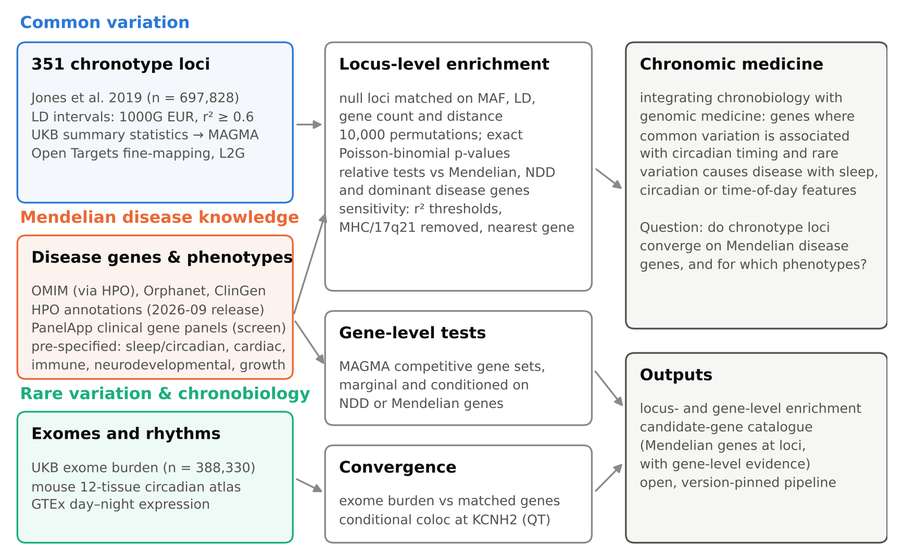
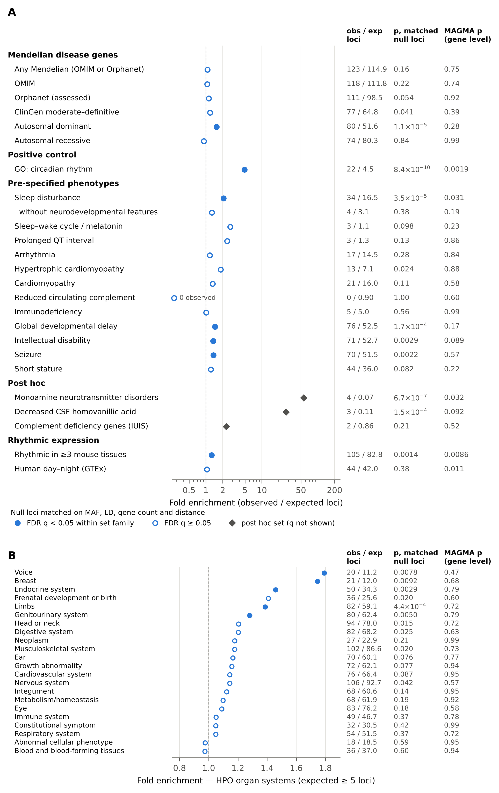
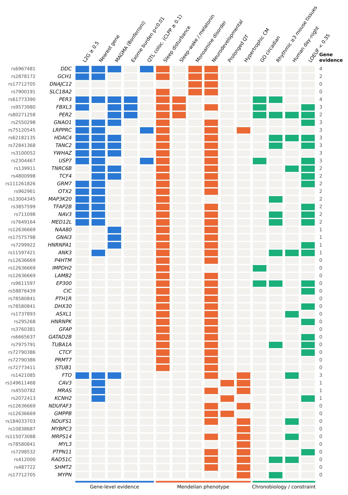
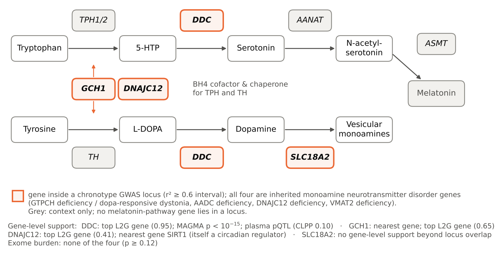
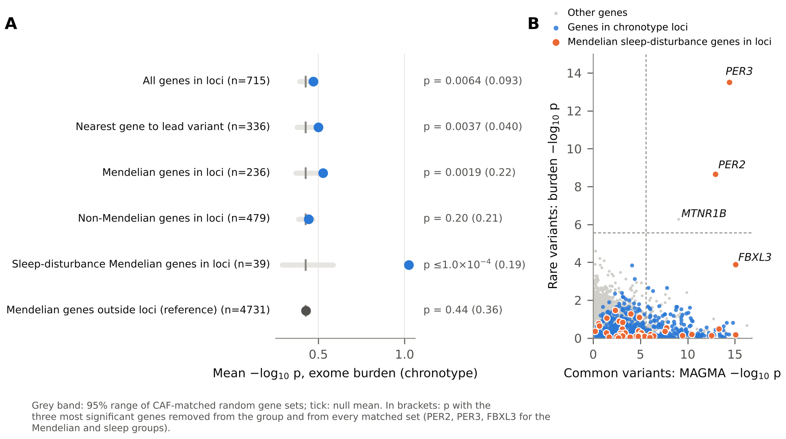
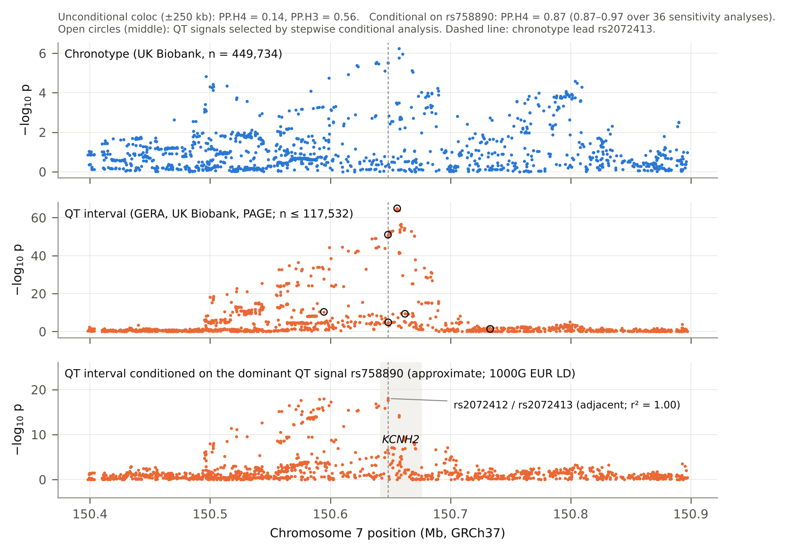

**Basimah T Malik**^1^ **and Timothy J Hearn**^1,2,\*^

^1^ Academic Department of Medical Genetics, University of Cambridge, Cambridge, UK\
^2^ Research Department of Cell and Developmental Biology, University College London, London, UK\
[AUTHORS TO UPDATE: current affiliations and ORCID iDs]

\* Corresponding author: Timothy J Hearn, [email address to be added]

**Running title:** Chronotype loci and Mendelian disease genes

**Keywords:** chronotype; circadian rhythms; chronomic medicine; Mendelian disease; genome-wide association study; rare variants; sleep; colocalisation

# Abstract

**Background:** Chronotype, the preferred timing of sleep and activity, is heritable, and genome-wide association studies have identified 351 associated loci. We define *chronomic medicine* as the integration of chronobiology with genomic medicine, and ask whether chronotype loci converge on Mendelian disease genes, and for which phenotypes.

**Methods:** We tested Mendelian disease genes (OMIM, Orphanet, ClinGen) and Human Phenotype Ontology gene sets at chronotype loci against null loci matched for allele frequency, linkage disequilibrium, gene count and gene distance. We added gene-set, fine-mapping, exome burden (UK Biobank, n = 388,330) and colocalisation analyses.

**Results:** Mendelian disease genes were not enriched overall (123 vs 114.9 expected loci; p = 0.16). Genes for autosomal dominant disorders (1.55-fold; p = 1.1×10^−5^) and for neurodevelopmental phenotypes were over-represented within loci, with little gene-level support. Genes for Mendelian disorders with sleep disturbance were over-represented (34 vs 16.5 loci; p = 3.5×10^−5^), including among loci containing dominant or neurodevelopmental disease genes, but most also cause neurodevelopmental disorders and gene-level support was nominal. Rare variants in *PER2* and *PER3* were associated with morningness, and with *FBXL3* these clock genes accounted for the excess rare-variant signal among Mendelian genes at the loci. Post hoc, 4 of 12 monoamine neurotransmitter disorder genes lay at chronotype loci. At the long QT syndrome gene *KCNH2*, conditioning suggested that a sub-genome-wide chronotype signal shares a variant with a secondary QT-interval signal (posterior probability 0.87).

**Conclusions:** Chronotype loci are not enriched for Mendelian disease genes in general. Convergence of common, rare and Mendelian variation is clearest at clock genes. Links to sleep-disturbance syndromes, monoamine synthesis and cardiac repolarisation are candidates for replication. We provide a catalogue of 236 Mendelian disease genes at chronotype loci and an open framework for chronomic medicine.

# Introduction

Circadian clocks organise physiology into approximately 24-hour programmes in almost every tissue. Circadian medicine seeks to use this temporal organisation in diagnosis, treatment and prevention [@cederroth2019fourth; @allada2021circadian; @kramer2022foundations]. Drug targets and disease processes vary over the day, so the timing of an intervention can change its effect [@ruben2019dosing; @ruan2021therapeutic]. In individuals, circadian timing is expressed as chronotype, the preferred timing of sleep and activity, which varies widely in the population [@roenneberg2007epidemiology; @roenneberg2016health]. Evening chronotype is associated with psychiatric, cardiometabolic and other diseases [@knutson2018chronotype], and Mendelian randomisation supports causal effects on some outcomes, including depression and breast cancer [@daghlas2021depression; @oloughlin2021mental; @richmond2019breast]. Genome-wide association studies (GWAS) of chronotype identified 12–16 loci in 2016 [@hu2016morning; @lane2016chronotype; @jones2016morningness] and 351 loci in a 2019 meta-analysis of 697,828 UK Biobank and 23andMe participants [@jones2019chronotype]. To our knowledge that study remains the largest; later efforts, including the multi-ancestry Pan-UK Biobank analyses, were smaller [@karczewski2025panukb; @lane2023genetics]. Chronotype loci are enriched for core clock genes and for genes involved in retinal light sensing, and they predict objectively measured sleep timing [@jones2019chronotype; @jones2019accelerometer].

Rare variation in the same pathways causes Mendelian circadian rhythm disorders. Familial advanced sleep phase is caused by variants in *PER2*, *CSNK1D*, *PER3*, *CRY2* and *TIMELESS* [@jones1999fasps; @toh2001per2; @xu2005csnk1d; @zhang2016per3; @hirano2016cry2; @kurien2019timeless]. Delayed sleep phase can be caused by *CRY1* variants [@patke2017cry1], and familial natural short sleep by variants in *BHLHE41*, *ADRB1*, *NPSR1* and *GRM1* [@he2009dec2; @shi2019adrb1; @xing2019npsr1; @shi2021grm1; @ashbrook2020genetics]. More broadly, sleep and circadian disturbance is common across rare genetic syndromes [@agar2021syndromes]; the inverted melatonin rhythm of Smith–Magenis syndrome is the best-known example [@potocki2000sms; @deleersnyder2001sms]. At population scale, however, reported Mendelian sleep variants have modest effects [@weedon2022mendelian], and exome sequencing has only begun to identify rare-variant associations with sleep traits [@backman2021exome; @fei2024exome].

Common and rare variants often implicate related genes. GWAS loci are enriched for Mendelian disease genes whose phenotype matches the complex trait [@blair2013nondegenerate; @freund2018mendelian], and this principle is used to prioritise genes at GWAS loci [@sobczyk2021mendelvar]. For most traits, genes implicated by common and by rare variants converge on shared biological networks even when few individual genes are shared [@wright2026network], and for some, such as anthropometric traits, they converge on the same genes [@hawkes2026wgs]. Testing such convergence is, however, prone to confounding. Gene-dense loci contain more genes of any kind, and loci in extended linkage disequilibrium (LD) span more genes. Enrichment tests against fixed genome-wide backgrounds with nominal p-values are a recognised source of false positives [@timmons2015bias; @wijesooriya2022enrichment]. To our knowledge, convergence between chronotype loci and Mendelian disease genes has not been examined with null models that control for gene density and LD.

The idea that physiology has a genetically influenced time structure is not new. Halberg and colleagues introduced the terms *chronome* and *chronomics* for the multi-frequency time structures of physiology [@halberg1999commentary; @halberg2001chronomics], and the terms *CircadiOmics* and *CircadiOmic medicine* have been used for circadian omics data [@patel2012circadiomics; @tabibzadeh2021circadiomic]. Here we use **chronomic medicine** to mean the integration of chronobiology with genomic medicine. Chronomic medicine uses genetic variation in timing pathways, together with the time-of-day dependence of gene expression, phenotypes and treatments, to understand, diagnose and manage disease. One of its first questions is where the genetics of circadian timing in the population meets the genetics of rare disease.

In this study we tested four questions. First, are chronotype loci enriched for Mendelian disease genes, overall and by phenotype, when compared with null loci matched for LD and gene density? Second, are phenotype sets with established links to circadian physiology enriched, judged against a circadian positive control? Third, does rare-variant burden converge on the same genes? Fourth, do the chronotype and QT-interval signals at *KCNH2*, a Mendelian arrhythmia gene at a chronotype locus, share a causal variant? We annotated the candidate genes with fine-mapping, colocalisation and circadian expression evidence, and we release every step as an open, version-pinned pipeline.

# Methods

## Study design

This is a secondary analysis of publicly available summary-level data, and no new participants were recruited. The design is summarised in Fig. 1. The phenotype hypotheses were specified before the enrichment analyses were run, but the analysis was not pre-registered. They comprised two groups. The first was Mendelian sleep and circadian phenotypes, with the Gene Ontology (GO) "circadian rhythm" gene set as a positive control. The second was phenotypes with established links to circadian physiology. These were cardiac electrophysiology and cardiomyopathy, because cardiac ion-channel expression is under clock control and arrhythmic events vary with time of day [@jeyaraj2012klf15; @schroder2015kcnh2; @black2019review]; complement and immune phenotypes, because immunity, including circulating complement, is under circadian control [@scheiermann2018clocking; @reis2011complement]; neurodevelopmental phenotypes, in which sleep disturbance is common [@agar2021syndromes]; and short stature, because growth hormone secretion is coupled to sleep [@takahashi1968gh; @vancauter1998somatotropic]. We also screened all organ systems of the Human Phenotype Ontology (HPO). At *KCNH2*, the gene for long QT syndrome type 2, the chronotype lead variant rs2072413 is also a known QT-interval variant [@arking2014qt], so we tested whether the two traits share a causal variant.

Several analyses were added post hoc. After inspecting the genes driving the sleep-disturbance signal, we defined a monoamine neurotransmitter disorder gene set and tested the related HPO term decreased CSF homovanillic acid. We added a curated complement deficiency set after we found that HPO annotations miss several complement deficiencies. At *KCNH2*, we added a conditional colocalisation analysis after the unconditional analysis indicated more than one QT signal in the region. Reporting follows the relevant items of STREGA and FAIR principles for data and software [@little2009strega; @wilkinson2016fair; @barker2022fair4rs].

## Chronotype loci and gene mapping

We used the 351 independent lead variants from the UK Biobank and 23andMe meta-analysis of Jones et al. (Supplementary Data 1) [@jones2019chronotype], with GRCh37 coordinates. LD was computed with PLINK v1.9 [@chang2015plink] in the 1000 Genomes phase 3 European panel (n = 503) [@auton2015kgp], restricted to variants with minor allele frequency (MAF) ≥ 1%. Of the lead variants, 341 were present in the panel. Two leads were represented by a panel variant at the same position. The remaining 8 (mostly indels) were represented by the most strongly associated panel variant within 100 kb in the UK Biobank-only statistics; for some of these proxies the UK Biobank association was weak (p up to 0.0097). For each lead variant we identified all panel variants with r^2^ ≥ 0.5 within ±1 Mb. The primary locus interval spanned all variants with r^2^ ≥ 0.6, padded by 10 kb; intervals at r^2^ ≥ 0.5 and ≥ 0.8 were used in sensitivity analyses. Overlapping intervals would have been merged, but none overlapped. The gene universe was the 20,145 protein-coding genes on the autosomes and X chromosome in GENCODE v48 (GRCh37 lift-over) [@mudge2025gencode], harmonised to HGNC symbols and Ensembl identifiers [@seal2023hgnc]. A gene was assigned to a locus if its body overlapped the interval. The nearest gene was the gene whose body was closest to the lead variant. Loci, intervals and genes are listed in Supplementary Table S1.

## Mendelian disease and phenotype gene sets

Gene–disease relationships were taken from three sources. From OMIM, we used links with a "MENDELIAN" association type, obtained through the HPO genes_to_disease file (mim2gene_medgen) [@amberger2019omim; @gargano2024hpo]. From Orphanet (product 6, June 2026 release), we used "disease-causing germline mutation" associations with "assessed" status [@lucano2026orphanet]. From ClinGen gene–disease validity [@strande2017clingen], we used moderate, strong or definitive classifications. High-confidence Mendelian genes were those with a ClinGen classification of moderate or above, or listed in both OMIM and Orphanet.

Phenotypes came from HPO annotations (release 2026-09-01), propagated up the ontology: a gene belongs to an HPO term set if any of its Mendelian diseases is annotated with that term or a descendant. We tested the 23 top-level organ-system terms (children of HP:0000118) and the pre-specified terms. These were sleep disturbance (HP:0002360); a circadian set comprising sleep–wake cycle disturbance (HP:0006979) or abnormal pineal melatonin secretion (HP:0012689); prolonged QT interval, arrhythmia, cardiomyopathy and hypertrophic cardiomyopathy; reduced circulating complement concentration (HP:0004431) and immunodeficiency; global developmental delay, intellectual disability and seizure; and short stature. HPO annotations of several complement deficiencies, including C2 deficiency (OMIM 217000), carry no complement term, so we also tested, post hoc, the 33 complement deficiency genes of the International Union of Immunological Societies (IUIS) classification of inborn errors of immunity [@tangye2022iuis].

Inheritance sets (autosomal dominant, autosomal recessive, X-linked) used HPO inheritance annotations. The positive control was GO:0007623 "circadian rhythm" and its descendants [@go2023]. To separate sleep from neurodevelopmental phenotypes, we also tested sleep-disturbance genes not annotated with global developmental delay, intellectual disability or seizure. The post hoc monoamine set comprised the 12 genes of the inherited monoamine neurotransmitter disorders (*TH*, *DDC*, *GCH1*, *PTS*, *SPR*, *QDPR*, *PCBD1*, *DNAJC12*, *SLC6A3*, *SLC18A2*, *DBH*, *MAOA*) [@kurian2011monoamine; @opladen2016intd; @opladen2020bh4]. Gene-set definitions and members are given in Supplementary Table S2.

## Locus-level enrichment against matched null loci

We implemented SNPsnap-style matching [@pers2015snpsnap] locally. We sampled 400,000 random variants (MAF ≥ 1%, autosomes and X, more than 1 Mb from any chronotype lead) and processed each exactly as the chronotype loci were processed. For each variant we computed the MAF, the number of LD partners at r^2^ ≥ 0.5, the r^2^ ≥ 0.6 interval and its protein-coding genes, and the distance to the nearest gene. Each chronotype locus was matched to pool variants in the same decile of MAF, LD partners and distance, and in the same gene-count class (0, 1, 2, 3, 4–5, 6–8, 9–13 or ≥ 14 genes). If fewer than 50 candidates remained, the match was relaxed by dropping distance, then LD partners, then MAF; gene count was always matched. Of the 351 loci, 317 were matched on all four features (median 489 candidates per locus).

The statistic for each gene set was the number of loci containing at least one member gene. Its null distribution was obtained from 10,000 draws of one matched variant per locus. Because loci are sampled independently, this null is a Poisson-binomial distribution. We therefore also computed exact upper-tail p-values from each locus's matched-candidate hit probability; these agreed with the permutation p-values and are reported throughout. Fold enrichment is the ratio of observed to expected loci, using the exact expectation. Benjamini–Hochberg false discovery rates (q) were computed within each family of gene sets [@benjamini1995fdr]. To test phenotype specificity, we took the loci containing a gene of a reference set (Mendelian genes, neurodevelopmental genes or autosomal dominant disease genes) and compared the fraction that also contained a gene of a given phenotype set with the same fraction in the matched null draws ("relative" tests).

Sensitivity analyses used r^2^ ≥ 0.5 and ≥ 0.8 intervals, excluded the MHC (chr6:25–34 Mb) and the 17q21.31 inversion region, or assigned only the nearest gene. All enrichment results are given in Supplementary Table S3.

## MAGMA gene and gene-set analysis

We ran MAGMA v1.10 [@deleeuw2015magma] on the UK Biobank chronotype summary statistics (continuous chronotype score, n = 449,734; GWAS Catalog GCST007576) [@jones2019chronotype; @bycroft2018ukb]. Variants were assigned to genes within 35 kb upstream and 10 kb downstream, and the SNP-wise mean model was used with the 1000 Genomes European reference. Competitive gene-set analyses included MAGMA's default covariates (gene size, gene density and inverse minor allele count). We ran marginal models and models conditioned on neurodevelopmental genes or on Mendelian genes. For the post hoc monoamine set we also left out each gene at a chronotype locus in turn. MAGMA p-values below its numerical floor are reported as < 10^−15^. The 23andMe component of the meta-analysis is not publicly available, so MAGMA used the UK Biobank-only statistics.

## Fine-mapping, locus-to-gene scores and QTL colocalisation

We retrieved 570 credible sets for three UK Biobank chronotype studies from the Open Targets Platform (release 26.09; API 26.9.0) [@buniello2025otp]. These were GCST007576 and GCST007565 (Jones et al. 2019; PICS fine-mapping) and GCST90691736 (Pan-UK Biobank European chronotype) [@karczewski2025panukb]. Of the GCST90691736 credible sets, 146 were fine-mapped with SuSiE-inf and 19 with PICS. We extracted locus-to-gene (L2G) scores [@mountjoy2021l2g] and colocalisations with molecular QTLs (eQTL, pQTL, sQTL, tuQTL and single-cell QTL) and with other GWAS.

For these credible sets Open Targets computes colocalisation from the fine-mapping posterior inclusion probabilities. It reports a coloc posterior for a shared variant, normalised so that H3 + H4 = 1, and the eCAVIAR colocalisation posterior probability (CLPP) [@hormozdiari2016ecaviar]. We retained colocalisations with CLPP ≥ 0.01, the eCAVIAR default; all had H4 > 0.9 on the normalised scale. Because these quantities are weaker evidence than standard coloc posteriors, we counted a gene as having QTL support only at CLPP ≥ 0.1. A credible set was linked to a chronotype locus if any of its variants was the lead variant or in r^2^ ≥ 0.6 with it.

## Rare-variant burden

We used UK Biobank exome burden statistics for the four answers to the chronotype question (field 1180) [@backman2021exome]. Each answer was analysed as a binary trait (category versus rest) in 388,330 participants of European ancestry (GWAS Catalog GCST90081559–62). Masks were predicted loss-of-function variants (pLOF; M1) or pLOF plus deleterious missense variants (M3), each at five frequency ceilings (singletons and MAF ≤ 0.001%, 0.01%, 0.1% and 1%). For each gene and trait we combined the ten masks with the aggregated Cauchy association test (ACAT) [@liu2019acat], and then combined the four traits. ACAT p-values are approximately calibrated under dependence between tests, particularly in the tail. Because the four category-versus-rest tests are two-sided and partly redundant, the combined p-value carries no direction. Direction was therefore assigned from the most significant mask, as the log odds ratio for "definitely a morning person" minus that for "definitely an evening person".

Gene groups were compared with 10,000 random gene sets matched on the decile of cumulative allele frequency of qualifying variants. We ran three sensitivity analyses. The first dropped the masks with a 1% frequency ceiling, which may tag common GWAS variants, leaving masks with MAF ≤ 0.1%. The second removed the three most significant genes from each group and from every matched set (trimmed mean). The third compared the remaining genes with untrimmed matched sets of the same size (leave-three-out), which is conservative. Permutation p-values have a floor of 1/10,001. Burden results are given in Supplementary Table S4.

## Circadian expression

We analysed the mouse 12-tissue circadian atlas (constant darkness, 2-hourly sampling over 48 h; GEO GSE54650) [@zhang2014atlas] by 24-hour harmonic regression. Genes were called rhythmic at Benjamini–Hochberg q < 0.05 within tissue and peak-to-trough amplitude ≥ 0.2 log~2~ units, and were mapped to human genes by one-to-one MGI homology [@baldarelli2024mgi]. Human day–night differential expression across 46 GTEx tissues was taken from Wucher et al. [@wucher2023daynight], requiring FDR < 0.05 and robustness to permutation. The sets "rhythmic in ≥ 3 mouse tissues" and "day–night in ≥ 1 GTEx tissue" were tested like the other gene sets.

## Candidate-gene evidence

For each Mendelian disease gene at a chronotype locus we recorded five lines of gene-level evidence. These were an L2G score ≥ 0.5 for the gene in a credible set at the locus; being the nearest gene to the lead variant; MAGMA Bonferroni significance; exome burden p < 0.01; and QTL colocalisation with CLPP ≥ 0.1. The lines are not independent (L2G, for example, uses distance and colocalisation features), so their count is a summary for ranking, not a probability. We also recorded each gene's loss-of-function (LoF) constraint, as the gnomAD v2.1.1 LOEUF score [@karczewski2020gnomad], for description only; constraint was not used in any test. The resulting catalogue is given in Supplementary Table S5.

## Colocalisation at KCNH2

We tested colocalisation of chronotype (GCST007576) with QT interval [@hoffmann2022qt]. The QT summary statistics (GCST90165291; n ≤ 117,532) come from a meta-analysis of the GERA, UK Biobank and PAGE cohorts. In this file the effect sizes and allele frequencies refer to the allele in the "other_allele" column. We confirmed this at variants with well-established QT-prolonging alleles (*NOS1AP* rs12143842 and rs10494366, and *KCNH2* rs1805123) and by allele-frequency concordance with UK Biobank. We used approximate Bayes factor coloc [@giambartolomei2014coloc] in windows of ±100, 250 and 500 kb around rs2072413, with priors p~1~ = p~2~ = 10^−4^ and p~12~ = 5×10^−6^, as recommended by Wallace [@wallace2020priors]. The method was implemented in Python and validated against simulated shared and distinct signals.

Coloc assumes at most one causal variant per trait, but the QT association at *KCNH2* comprises several signals. In the post hoc conditional analysis we therefore computed approximate conditional QT z-scores [@yang2012cojo]. These used signed LD from the 1000 Genomes European panel with light regularisation and were restricted to variants analysed in all QT cohorts (n ≥ 95% of the maximum). Our primary analysis conditioned the QT statistics on the dominant QT signal only, the model with the fewest LD-dependent assumptions, and then tested colocalisation with chronotype. As a sensitivity analysis, we identified independent QT signals by forward stepwise selection (continuing while the strongest conditional association reached p < 5×10^−8^) and tested each signal, conditioned on all others, for colocalisation. We repeated the analysis over 36 combinations of window (±100 or ±250 kb), LD regularisation (0.001, 0.01 or 0.05), conditioning set (the dominant signal only, all other signals, or all but the weakest) and p~12~ (5×10^−6^ or 10^−5^). Results are given in Supplementary Table S6.

## Software and reproducibility

Analyses used Python 3.13.18 (numpy, pandas, scipy, statsmodels, obonet, networkx), PLINK v1.9 and v2.0, and MAGMA v1.10. Every input is retrieved by a script that records its source URL or API endpoint, retrieval time and MD5 checksum (53 files; Supplementary Table S6). All analyses, figures, tables and numbers quoted in this manuscript are regenerated from these inputs by numbered scripts. Statistical helpers are unit-tested, and the random seed is fixed (20260101). Code is available at https://github.com/comparativechrono/ChronomicMedicinePaper.

# Results

## Chronotype loci and their genes

The 351 chronotype loci were independent (no overlapping intervals; median interval 84 kb). They contained 761 protein-coding genes, and 90 loci contained none. Open Targets credible sets were linked to 295 loci. An L2G gene was available for 273 of these loci (203 with score ≥ 0.5), and it was the nearest gene at 228. A molecular QTL colocalised with CLPP ≥ 0.1 at 48 loci, and with CLPP ≥ 0.01 at 143. MAGMA identified 429 genes at Bonferroni significance (p < 2.6×10^−6^). In all, 123 loci contained at least one of 236 Mendelian disease genes.

## Mendelian disease genes are not enriched overall, but dominant and neurodevelopmental disease genes are over-represented within loci

Against matched null loci, 123 chronotype loci contained a Mendelian disease gene, compared with 114.9 expected (1.07-fold; p = 0.16; Fig. 2A, Table 1). Results were similar for every interval definition, after excluding the MHC and 17q21.31, and when only the nearest gene was considered (0.91-fold; p = 0.88). No Mendelian gene set (OMIM, Orphanet, ClinGen-validated or high-confidence genes) reached FDR < 0.05 in any analysis; ClinGen-validated genes were nominally enriched in the primary analysis (1.19-fold; p = 0.041; q = 0.090). MAGMA gave the same answer (p = 0.75).

Genes for autosomal dominant disorders were, however, over-represented (80 vs 51.6 loci; 1.55-fold; p = 1.1×10^−5^), also relative to other Mendelian genes (p ≤ 1.0×10^−4^), whereas genes for autosomal recessive disorders were not (74 vs 80.3 loci; p = 0.84). Neurodevelopmental phenotypes were also over-represented: global developmental delay (1.45-fold; p = 1.7×10^−4^), intellectual disability (1.35-fold; p = 0.0029) and seizure (1.36-fold; p = 0.0022). Of the 23 HPO organ systems, 5 reached FDR < 0.05 (limbs, endocrine system, genitourinary system, voice and breast; Fig. 2B). These enrichments were modest (1.28- to 1.79-fold), and gene-level support was weak. In MAGMA, which asks whether the genes themselves carry more chronotype association than other genes, none of these sets was enriched in the marginal model (all p ≥ 0.089; Fig. 2). Conditioned on Mendelian genes, only intellectual disability (p = 0.019) and the combined neurodevelopmental set (p = 0.037) reached nominal significance.

The circadian positive control behaved as expected. Genes annotated to the GO term "circadian rhythm" were found at 22 loci against 4.5 expected (4.9-fold; p = 8.4×10^−10^). The set was also enriched in MAGMA (p = 0.0019), including after conditioning on neurodevelopmental genes (p = 0.0020) or Mendelian genes (p = 0.0018). The framework therefore detects known chronotype biology at both the locus and the gene level.

## Mendelian sleep-disturbance genes are over-represented, including among loci with dominant or neurodevelopmental disease genes

Genes for Mendelian disorders annotated with sleep disturbance lay in 34 loci against 16.5 expected (2.06-fold; p = 3.5×10^−5^; q = 4.1×10^−4^). This was the strongest of the pre-specified phenotypes. It held with r^2^ ≥ 0.8 intervals (p = 0.0039), after excluding the MHC and 17q21.31 (p = 1.6×10^−5^) and with nearest-gene assignment (1.79-fold; p = 0.0064).

Sleep-disturbance genes were also over-represented relative to other disease genes. Among loci containing a Mendelian gene, 27.6% contained a sleep-disturbance gene, compared with 14.3% expected (p = 2.0×10^−4^). The excess was not explained by dominant inheritance or neurodevelopmental status alone. Among loci containing an autosomal dominant disease gene, 32.5% contained a sleep-disturbance gene, against 19.2% expected (p = 0.013). Among loci containing a neurodevelopmental disorder gene, 38.4% did so, against 21.7% expected (p = 0.0016). Both relative excesses held in every sensitivity analysis (p ≤ 0.039 and p ≤ 0.017, respectively). This included nearest-gene assignment (p = 0.0029 and p = 0.0059), in which each locus contributes a single gene, so the fractions cannot be inflated by loci carrying several dominant or neurodevelopmental disease genes. Most of the genes involved, however, cause neurodevelopmental disorders (35 of the 39 sleep-disturbance genes at chronotype loci, 24 of them with dominant inheritance). Sleep-disturbance genes without neurodevelopmental features were not enriched, although this set is small (72 genes; 4 vs 3.1 loci; p = 0.38), and neither was the small circadian HPO set (3 vs 1.1; p = 0.098). In MAGMA the sleep-disturbance set was nominally enriched (p = 0.031), including after conditioning on Mendelian genes (p = 0.016), but not after conditioning on neurodevelopmental genes (p = 0.051).

The genes behind the signal fall into three groups (Fig. 3, Table 2). The first comprises core clock genes: *PER2* and *PER3*, which cause familial advanced sleep phase, and *FBXL3*, whose recessive disorder is annotated with sleep–wake cycle disturbance on the basis of 1/8 reported patients [@ansar2019fbxl3]. These three genes are also the three hits in the circadian set. The second is a larger group of neurodevelopmental disorder genes in which disturbed sleep is a recognised feature, including *TCF4* (Pitt–Hopkins syndrome), *EP300* (Rubinstein–Taybi syndrome), *USP7* (Hao–Fountain syndrome), *GNAO1*, *YWHAZ*, *TNRC6B* and *HDAC4*; several lie in multi-gene loci, and some, such as *EP300*, have no gene-level support. The third group, which we did not expect, comprises genes of the monoamine neurotransmitter pathway.

## Post hoc: monoamine synthesis and storage genes

*GCH1*, *DDC* and *SLC18A2* were among the sleep-disturbance genes, and a fourth monoamine disorder gene, *DNAJC12*, lay in a further chronotype locus. Four of the 12 inherited monoamine neurotransmitter disorder genes therefore fall within chronotype loci, against 0.07 expected (Table 1), and all four were present at every LD threshold. Because the set was defined after inspection of the sleep-disturbance genes, its nominal p-values (Table 1) are not corrected for the selection step and are not evidence in their own right. Two further observations do not independently support the finding. The HPO biomarker set "decreased CSF homovanillic acid" had three hits (*DDC*, *GCH1* and *IMPDH2*), two of which are monoamine genes. The modest MAGMA result for the monoamine set (p = 0.032) depended on *DDC* (p = 0.14 without it).

Gene-level support for the four genes was uneven (Fig. 4). *DDC* had the strongest support: it was the L2G gene at its locus (score 0.95), had MAGMA p < 1×10^−15^ and colocalised with a plasma pQTL (CLPP 0.10). *GCH1* was both the nearest gene and the L2G gene (0.65). *DNAJC12* was the top L2G gene at its locus, but with a score below 0.5 (0.41). The nearest gene there, *SIRT1*, is itself a circadian regulator annotated to the GO term "circadian rhythm" and is a strong alternative candidate. *SLC18A2* had no support beyond locus overlap. None of the four genes had an exome burden signal (p 0.12–0.72). The four genes act at successive steps of monoamine synthesis and storage. GCH1 makes tetrahydrobiopterin, the cofactor of tryptophan and tyrosine hydroxylases, and DNAJC12 is a co-chaperone of these hydroxylases. DDC decarboxylates 5-hydroxytryptophan and L-DOPA to serotonin and dopamine, and SLC18A2 (VMAT2) loads both into vesicles [@kurian2011monoamine; @anikster2017dnajc12; @rilstone2013vmat2]. No gene of the melatonin branch lay in a chronotype locus.

## Rare-variant burden converges on core clock genes

Three genes reached exome-wide significance for chronotype in the UK Biobank exome burden data (p < 2.7×10^−6^), all three for morningness (Fig. 5). For *PER2* (p = 2.2×10^−9^), the signal came from the rarest pLOF variants (MAF ≤ 0.001%), which increased the odds of being "definitely a morning person" (odds ratio 2.78; p = 1.6×10^−10^). For *PER3* (p = 3.2×10^−14^), the signal was strongest in the mask that includes deleterious missense variants up to 1% frequency. It was weaker, and not exome-wide significant, with masks restricted to MAF ≤ 0.1% (p = 3.1×10^−5^) and with pLOF variants only (best mask p = 2.4×10^−6^). The third gene was *MTNR1B* (p = 5.1×10^−7^), which encodes the melatonin receptor MT2. Its signal also depended on the 1% masks (MAF ≤ 0.1% only: p = 0.0054). *MTNR1B* lies 176 kb from a chronotype lead variant (rs1508608), outside our LD interval, and showed a common-variant gene-level signal (MAGMA p = 9.1×10^−10^); rare *MTNR1B* LoF variants are known to raise type 2 diabetes risk [@bonnefond2012mtnr1b]. Deleterious *FBXL3* variants were nominally associated with eveningness (gene-level p = 1.3×10^−4^; odds ratio 2.50 for "definitely an evening person"), consistent with the lengthened circadian period of *Fbxl3* mutant mice [@godinho2007fbxl3; @siepka2007fbxl3].

As a group, genes in chronotype loci carried more rare-variant signal than random genes matched on cumulative allele frequency (p = 0.0064). The excess was concentrated in Mendelian genes in loci. These had a higher mean −log~10~ p than matched sets (p = 0.0019) and 8 genes with burden p < 0.01 against 2.7 expected (p = 0.0045). Non-Mendelian genes in loci showed no excess (p = 0.20), and neither did Mendelian genes outside loci (p = 0.44). The strongest convergence was for Mendelian sleep-disturbance genes in loci (p ≤ 1.0×10^−4^).

The excess among Mendelian genes was attributable to three genes, *PER3*, *PER2* and *FBXL3*. When these genes were removed from the group, and the three most significant genes from every matched set, Mendelian genes in loci no longer differed from matched sets (p = 0.22), and neither did sleep-disturbance genes (p = 0.19). In the conservative leave-three-out comparison, the remaining Mendelian genes had 5 genes with p < 0.01 against 2.6 expected (p = 0.12). The genes nearest to lead variants also carried excess signal (p = 0.0037). This was weaker after trimming (p = 0.040) and absent in the leave-three-out comparison (p = 0.19). Results were similar when the masks with a 1% frequency ceiling were dropped (Mendelian genes in loci p = 0.026; sleep-disturbance genes p = 2.0×10^−4^; Supplementary Table S4).

## Cardiac and immune phenotypes, and a candidate shared signal at KCNH2

The cardiac and immune phenotype sets were not enriched after correction (Table 1). Prolonged-QT genes lay in 3 loci (*KCNH2*, *CAV3*, *GMPPB*) against 1.3 expected (p = 0.13). Hypertrophic cardiomyopathy genes lay in 13 loci against 7.1 expected (p = 0.024; q = 0.058). The relative test was nominal (p = 0.030), and MAGMA did not support the set (p = 0.88). No locus contained a gene annotated with reduced circulating complement. The post hoc IUIS complement deficiency set had 2 hits, *C2* (in the MHC class III region) and *CD59*, against 0.9 expected (p = 0.21). Immunodeficiency genes (p = 0.56) and short stature genes (p = 0.082) were not enriched.

At *KCNH2*, the chronotype lead variant rs2072413 is strongly associated with QT interval (p = 2.2×10^−51^). Its chronotype association in the UK Biobank-only statistics, however, does not reach genome-wide significance (p = 3.5×10^−6^; regional minimum p = 7.1×10^−7^). In the standard coloc analysis, distinct causal variants were favoured over a shared one (±250 kb: PP.H3 = 0.56, PP.H4 = 0.14; similar at ±100 and ±500 kb). The strongest QT variant (rs758890) was only weakly correlated with rs2072413 (r^2^ = 0.17). Yet rs2072413 was far more strongly associated with QT interval than this LD alone would predict, which points to more than one QT signal.

In the post hoc conditional analysis, conditioning the QT statistics on the dominant signal (rs758890) left a QT association at rs2072413 (z = 8.7) that colocalised with chronotype (PP.H4 = 0.87; PP.H3 = 0.08; Supplementary Fig. S1, Supplementary Table S6). PP.H4 ranged from 0.87 to 0.97 across windows, LD regularisation and priors. The shared signal is tagged by rs2072413 and rs2072412, adjacent variants in complete LD (r^2^ = 1.00) that the data cannot distinguish. The rs2072413 C allele, which is associated with morningness (meta-analysis ln OR 0.021), was associated with a longer QT interval (1.47 ms per allele).

The stepwise joint model identified 6 QT signals (5–7 across settings) and gave a similar posterior for the signal tagged by rs2072412 (PP.H4 = 0.94; 0.87–0.97 over all 36 settings). No other QT signal colocalised with chronotype (maximum PP.H4 = 0.17). The joint model itself was unstable, however. The dominant signal reversed sign when conditioned on the others (z = 17.1 marginally, -13.0 to -2.5 conditionally), and one selected signal had a marginal p of only 0.04. This pattern is typical of a mismatch between the reference panel and the GWAS sample.

## Circadian expression

Genes rhythmic in at least three mouse tissues were modestly enriched at chronotype loci (1.27-fold; p = 0.0014) and in MAGMA (p = 0.0086). Human day–night differentially expressed genes were not enriched at the locus level (p = 0.38), but had nominal support in MAGMA (p = 0.011). At the gene level, *PER2* and *PER3* were rhythmic in all 12 mouse tissues, and *KCNH2* in heart, consistent with clock control of cardiac *Kcnh2* [@schroder2015kcnh2]. *DDC* was rhythmic in kidney and liver, and *GCH1* in liver (Supplementary Table S5).

## A catalogue of chronomic candidate genes

Supplementary Table S5 lists the 236 Mendelian disease genes at the 123 chronotype loci that contain one. For each gene it gives the diseases, inheritance and ClinGen classification, phenotype flags, gene-level evidence, rare-variant burden, constraint and circadian expression. Of these genes, 32 have at least three of the five lines of gene-level evidence, and 4, including *PER3* and *DDC*, have four or more. Fig. 3 and Table 2 summarise the genes with sleep, circadian, monoamine or cardiac phenotypes.

# Discussion

Chronotype loci are not a reservoir of rare disease genes in general. Once gene density and LD are matched, Mendelian disease genes occur at chronotype loci no more often than at random loci. Genes for dominant and neurodevelopmental disorders, and for several organ systems, were modestly over-represented within loci, with little gene-level support.

Convergence between chronotype genetics and Mendelian disease is limited. Apart from a modest and broad excess of dominant, neurodevelopmental and organ-system disease genes within loci, which has little gene-level support, it is clearest at core clock genes. Common chronotype variants, rare population variants and Mendelian disease variants meet at *PER2*, at *PER3* (where the rare-variant evidence depends partly on missense variants up to 1% frequency) and possibly at *FBXL3*. Genes for disorders with disturbed sleep are over-represented at chronotype loci, including among loci containing dominant or neurodevelopmental disease genes, although most of these genes also cause neurodevelopmental disorders and their gene-level support is nominal. Post hoc analyses point to monoamine synthesis and storage and, at *KCNH2*, to a candidate shared variant for chronotype and QT interval. Within the limits of these data, *PER2* and *PER3* are the clearest current examples of chronomic medicine, and the other links are candidates for replication.

Two methodological points apply beyond chronotype. First, matched null loci are essential. Chronotype loci differ from random genomic regions in gene density, LD and gene content, and enrichment tests against a fixed genome-wide background do not account for this [@timmons2015bias; @wijesooriya2022enrichment]. Second, locus-level and gene-level tests answer different questions and are worth reporting together. A locus-level test counts genes that lie within loci, whereas a gene-level test such as MAGMA asks whether the genes themselves carry more association than other genes. In our data, the circadian control and genes rhythmic in mouse tissues were supported at both levels, whereas gene-level support for the disease-gene sets, including sleep disturbance, was at most nominal.

The sleep-disturbance signal links chronotype loci to the large group of rare neurodevelopmental syndromes in which sleep problems are common and often a major burden for families [@agar2021syndromes]. In some syndromes, such as Smith–Magenis syndrome, the circadian mechanism is established [@potocki2000sms; @deleersnyder2001sms]. The genes for others, including Pitt–Hopkins, Rubinstein–Taybi and Hao–Fountain syndromes, lie at chronotype loci. Our data do not show that these genes are the effector genes at those loci (*EP300*, for example, has no gene-level support). Nor can they fully separate the sleep phenotype from the neurodevelopmental one. Sleep-disturbance genes were over-represented even among loci containing neurodevelopmental or dominant disease genes, but most of the genes involved cause both, and the gene-level evidence was nominal. Whether sleep problems in these syndromes have a circadian-phase component is nevertheless testable with actigraphy, dim-light melatonin onset or chronotype questionnaires, and the answer would matter for treatment with timed light or melatonin.

The monoamine finding was not anticipated and was defined post hoc, so it needs independent replication. It is biologically coherent: *GCH1*, *DNAJC12*, *DDC* and *SLC18A2* act at successive steps of serotonin and dopamine synthesis and storage. The evidence is, however, uneven. Only *DDC* and *GCH1* have gene-level support, the *DNAJC12* locus has a strong alternative candidate in the circadian regulator *SIRT1*, and none of the four genes has a rare-variant signal in population exomes. Some of the disorders these genes cause have notable temporal features. *GCH1*-related dopa-responsive dystonia, or Segawa disease, shows marked diurnal fluctuation: symptoms are mild in the morning and worsen through the day, improving after sleep [@segawa2011drd; @ichinose1994gch1]. Sleep disturbance is common in AADC deficiency [@wassenberg2017aadc]. These disorders are also treatable. DNAJC12 deficiency and the BH4 deficiencies respond to monoamine precursors or cofactors [@anikster2017dnajc12; @opladen2020bh4], whereas VMAT2 deficiency responds to dopamine agonists and is worsened by levodopa [@rilstone2013vmat2]. The timing of doses, and of CSF neurotransmitter sampling, are natural targets for chronomic studies in these rare disorders. These are hypotheses that our data motivate but do not test.

The rare-variant results agree with known circadian biology. Rare variants in *PER2* and *PER3* were associated with morningness, matching the advanced sleep phase of the corresponding Mendelian disorders [@toh2001per2; @zhang2016per3]. The *PER2* signal came from the rarest pLOF variants. The *PER3* signal was strongest when missense variants up to 1% frequency were included, so part of it may reflect less rare variants, and it cannot be attributed to loss of function alone. Deleterious *FBXL3* variants were nominally associated with eveningness, matching the long period of *Fbxl3* mutant mice [@godinho2007fbxl3; @siepka2007fbxl3]. These population effects are much smaller than in families, consistent with the modest penetrance of reported Mendelian sleep variants [@weedon2022mendelian]. The excess burden signal among Mendelian genes at chronotype loci was attributable to these clock genes, and we found little evidence of more widespread rare-variant convergence. The *MTNR1B* association with morningness depended on the masks up to 1% frequency, and the gene lies outside the chronotype loci. It may therefore partly reflect common variation near *MTNR1B*, which also has a common-variant gene-level signal.

At *KCNH2*, our data suggest that a chronotype signal and a secondary QT-interval signal may share a causal variant, at which the allele associated with morningness would lengthen the QT interval. Cardiac repolarisation is under circadian control: the cardiomyocyte clock regulates *Kcnh2* expression and ventricular repolarisation [@jeyaraj2012klf15; @schroder2015kcnh2; @black2019review], and cardiac events in long QT syndrome cluster by time of day in a genotype-dependent way [@schwartz2001genotype; @takigawa2012lqts]. A variant that influences both circadian preference and the QT interval would therefore be of interest for chronomic medicine. The evidence is, however, limited. The conditional analysis was post hoc, and the chronotype association at this locus is not genome-wide significant in the UK Biobank data. The joint conditional model showed signs of mismatch between the 503-sample European reference panel and the multi-ancestry QT meta-analysis. The gene through which the variant acts is unknown: *KCNH2* has little other gene-level support for chronotype and is also expressed in the brain. The finding should be tested with in-sample LD (for example, conditional or SuSiE-based colocalisation in UK Biobank) and an independent chronotype GWAS. Complement and immune phenotypes, by contrast, were not enriched, despite strong evidence for circadian control of immunity [@scheiermann2018clocking].

One practical observation concerns phenotype ontologies. HPO includes modifiers for temporal patterns, such as "Diurnal" (HP:0025302), "Fluctuating" (HP:0031914), "Nocturnal" (HP:0025301) and "Worse in evening" (HP:0410401). In the release we used, the diurnal, fluctuating and worse-in-evening modifiers together accounted for 0 of the 286,651 disease–phenotype annotations, and the nocturnal modifier for 1. The 134 annotations with any temporal-pattern modifier mostly described recurrence or chronicity. Dopa-responsive dystonia, a textbook example of a disease with diurnal fluctuation, is not annotated as such. Apart from a few phenotype terms that build in timing, such as nocturnal seizures, time-of-day features of rare diseases are therefore largely absent from the annotations that computational analyses such as ours depend on. Systematic chronomic phenotyping, meaning annotation of when symptoms, events and biomarker abnormalities occur, would be a straightforward step towards chronomic medicine.

This study has limitations. All chronotype data were from individuals of European ancestry, and chronotype was self-reported. The MAGMA, burden and colocalisation analyses used UK Biobank data alone, because the 23andMe statistics are not public, and the LD reference contained only 503 individuals. Gene-to-disease and phenotype annotations are incomplete and biased towards well-studied syndromes. Matching on gene count approximates, but does not eliminate, differences between chronotype and null loci. GWAS signals tend to lie near LoF-constrained, dosage-sensitive genes, which are over-represented among genes for dominant and neurodevelopmental disorders [@mostafavi2023systematic; @karczewski2020gnomad], so some of the locus-level enrichments, including that of sleep-disturbance genes, may partly reflect this general property. We did not adjust for constraint, because it may itself lie on the causal path from gene to phenotype, in which case adjustment would remove true signal. The analysis plan was not pre-registered, and several analyses were added post hoc. The ACAT combination of burden tests is approximate and discards direction, and the four chronotype categories are not independent. The Open Targets colocalisations were derived from fine-mapping posteriors rather than full coloc. The *KCNH2* conditional analysis used an external LD reference, and the chronotype and QT GWAS share UK Biobank participants. The circadian expression data came from mouse tissues and from human post-mortem day–night contrasts, both of which have limited power. Finally, enrichment at the locus level does not identify causal genes. The evidence lines in the catalogue are not independent, and the catalogue should be read as a ranked list of candidates rather than a set of confirmed effector genes.

In conclusion, chronotype genetics does not converge with rare disease in general. Convergence is clearest at core clock genes, where common, rare and Mendelian variation point the same way. Sleep-disturbance syndromes, monoamine synthesis and cardiac repolarisation at *KCNH2* are candidate links that need replication. We hope that the catalogue, the open pipeline and the explicit definition offered here help to make chronomic medicine a testable programme of research.

# Declarations

**Data availability.** All data are publicly available. They comprise the chronotype GWAS (Jones et al. 2019; GWAS Catalog GCST007576 and GCST007565, and Supplementary Data 1 of the original article); the 1000 Genomes phase 3 European reference (MAGMA build); GENCODE v48 and HGNC; HPO (release 2026-09-01), Orphanet product 6 and ClinGen gene–disease validity; gnomAD v2.1.1 constraint; Gene Ontology; Open Targets Platform 26.09; UK Biobank exome burden statistics (GCST90081559–62); the QT-interval GWAS (GCST90165291); GEO GSE54650; and the GTEx day–night tables of Wucher et al. (figshare). URLs, retrieval dates and checksums are listed in Supplementary Table S6. Results are provided in Supplementary Tables S1–S6.

**Code availability.** The complete pipeline is available at https://github.com/comparativechrono/ChronomicMedicinePaper [AUTHORS: archive the release on Zenodo and add the DOI].

**Acknowledgements.** BTM was supported by a Genetics Society 2020 summer studentship awarded to TJH. We thank the investigators and participants of UK Biobank, 23andMe, the 1000 Genomes Project, GTEx, gnomAD and the GERA, PAGE and UK Biobank QT studies, and the curators of OMIM, Orphanet, ClinGen, HPO, Gene Ontology and Open Targets for making their data openly available.

**Funding.** Genetics Society summer studentship (2020). [AUTHORS: add any further funding.]

**Author contributions (CRediT).** BTM: conceptualisation, investigation, formal analysis (initial analyses) and writing (original draft). TJH: conceptualisation, methodology, software, formal analysis, supervision, funding acquisition, and writing (original draft, review and editing). Both authors approved the final manuscript. [AUTHORS: confirm.]

**Competing interests.** The authors declare no competing interests. [AUTHORS: confirm.]

**Use of generative AI.** The analysis code and the manuscript text were developed with the assistance of an AI system (Claude, Anthropic). The authors specified the research questions, reviewed all code, analyses and text, and take full responsibility for the content. [AUTHORS: confirm and adapt to the journal's policy.]

**Ethics.** This study used only publicly available summary-level data, and no ethical approval was required.

# Tables

**Table 1. Locus-level and gene-level enrichment of selected gene sets at 351 chronotype loci.** Loci obs/exp: number of loci whose r^2^ ≥ 0.6 interval contains at least one gene of the set, observed and expected under matched null loci (exact Poisson-binomial expectation and p-value; 10,000 permutations agreed). Fold: observed/expected. q: Benjamini–Hochberg false discovery rate within set family (not given for post hoc sets). MAGMA p: marginal competitive gene-set p-value from UK Biobank chronotype statistics. The post hoc sets (monoamine disorders, decreased CSF homovanillic acid and IUIS complement deficiency) were defined after inspection of other results, and their p-values do not account for the selection. Full results, sensitivity analyses and relative tests are in Supplementary Table S3.

| Gene set | Genes | Loci obs/exp (fold) | p | q | MAGMA p |
|:------------------------------|-------:|:----------------|:----------|:----------|:---------|
| ***Mendelian disease genes*** | | | | | |
| Any Mendelian (OMIM or Orphanet) | 5,001 | 123/114.9 (1.07) | 0.16 | 0.20 | 0.75 |
| ClinGen moderate–definitive | 2,486 | 77/64.8 (1.19) | 0.041 | 0.090 | 0.39 |
| Autosomal dominant disorders | 1,857 | 80/51.6 (1.55) | 1.1×10^−5^ | 3.4×10^−5^ | 0.28 |
| Autosomal recessive disorders | 3,168 | 74/80.3 (0.92) | 0.84 | 1.00 | 0.99 |
| ***Positive control*** | | | | | |
| GO: circadian rhythm | 202 | 22/4.5 (4.92) | 8.4×10^−10^ | 8.4×10^−10^ | 0.0019 |
| ***Pre-specified phenotypes*** | | | | | |
| Sleep disturbance | 544 | 34/16.5 (2.06) | 3.5×10^−5^ | 4.1×10^−4^ | 0.031 |
| Sleep disturbance, excluding neurodevelopmental genes | 72 | 4/3.1 (1.28) | 0.38 | 0.38 | 0.19 |
| Sleep–wake cycle disturbance or abnormal melatonin | 43 | 3/1.1 (2.72) | 0.098 | 0.17 | 0.23 |
| Prolonged QT interval | 49 | 3/1.3 (2.39) | 0.13 | 0.18 | 0.86 |
| Hypertrophic cardiomyopathy | 254 | 13/7.1 (1.83) | 0.024 | 0.058 | 0.88 |
| Reduced circulating complement (HPO) | 28 | 0/0.90 (0.00) | 1.00 | 1.00 | 0.60 |
| Global developmental delay | 1,972 | 76/52.5 (1.45) | 1.7×10^−4^ | 1.0×10^−3^ | 0.17 |
| Intellectual disability | 1,955 | 71/52.7 (1.35) | 0.0029 | 0.0086 | 0.089 |
| Seizure | 1,908 | 70/51.5 (1.36) | 0.0022 | 0.0086 | 0.57 |
| ***Post hoc*** | | | | | |
| Monoamine neurotransmitter disorders (12 genes) | 12 | 4/0.07 (56) | 6.7×10^−7^ | – | 0.032 |
| Decreased CSF homovanillic acid | 10 | 3/0.11 (27) | 1.5×10^−4^ | – | 0.092 |
| Complement deficiency genes (IUIS) | 33 | 2/0.86 (2.32) | 0.21 | – | 0.52 |
| ***Rhythmic expression*** | | | | | |
| Rhythmic in ≥3 mouse tissues | 3,224 | 105/82.8 (1.27) | 0.0014 | 0.0029 | 0.0086 |
| Human day–night (GTEx) | 1,652 | 44/42.0 (1.05) | 0.38 | 0.38 | 0.011 |


**Table 2. Selected chronomic candidate genes: Mendelian disease genes at chronotype loci with sleep, circadian, monoamine or cardiac phenotypes.** L2G score: the gene's highest Open Targets locus-to-gene score at the locus, with the top L2G gene at the locus in brackets if it is a different gene (–: no L2G prediction for the gene). MAGMA p: gene-level p for UK Biobank chronotype. Exome burden: ACAT-combined burden p, with the direction of effect (towards morning or evening preference) shown when p < 0.05. QTL CLPP: largest eCAVIAR colocalisation posterior probability between the chronotype credible set and a QTL for the gene (Open Targets; –: below 0.01). Rhythmic (mouse): number of 12 mouse tissues with 24-h rhythmic expression. Evid.: number of five gene-level evidence lines, which are not independent (L2G ≥ 0.5 for the gene, nearest gene, MAGMA Bonferroni, burden p < 0.01, QTL CLPP ≥ 0.1). The full catalogue is in Supplementary Table S5.

| Gene | Lead variant | Mendelian disorder (inheritance) | L2G score (top gene if different) | MAGMA p | Exome burden p (direction) | QTL CLPP | Rhythmic (mouse) | Evid. |
|:-----------|:-------------|:-------------------|:------------|:----------|:-------------|:-------|:-----------|:-----:|
| *PER3* | rs61773390 | Familial advanced sleep phase syndrome 3 (AD) | 0.69 | 3.8×10^−15^ | 3.2×10^−14^ (morning) | 0.052 | 12/12 | 4 |
| *PER2* | rs80271258 | Familial advanced sleep phase syndrome 1 (AD) | 0.11 (IFT54 0.50) | 1.1×10^−13^ | 2.2×10^−9^ (morning) | 0.015 | 12/12 | 2 |
| *FBXL3* | rs9573980 | Intellectual developmental disorder with short stature, facial anomalies and speech defects (AR) | 0.57 (CLN5 0.59) | <1×10^−15^ | 1.3×10^−4^ (evening) | 0.028 | 2/12 | 3 |
| *DDC* | rs6967481 | AADC deficiency (AR) | 0.95 | <1×10^−15^ | 0.65 | 0.10 | 2/12 | 4 |
| *GCH1* | rs2878172 | Dopa-responsive dystonia; GTPCH deficiency (AD/AR) | 0.65 | 0.0018 | 0.12 | 0.015 | 1/12 | 2 |
| *DNAJC12* | rs17712705 | DNAJC12-deficient hyperphenylalaninaemia (AR) | 0.41 | 6.5×10^−6^ | 0.35 | – | 1/12 | 0 |
| *SLC18A2* | rs7900191 | Brain dopamine–serotonin vesicular transport disease (AR) | – | 1.3×10^−5^ | 0.72 | – | 0/12 | 0 |
| *TCF4* | rs4800998 | Pitt–Hopkins syndrome (AD) | 0.49 | 2.5×10^−8^ | 0.44 | – | 2/12 | 2 |
| *YWHAZ* | rs3100052 | Popov–Chang syndrome (AD) | 0.85 | 4.1×10^−7^ | 0.76 | 0.097 | 2/12 | 3 |
| *GNAO1* | rs2550298 | GNAO1 encephalopathy (DEE17/NEDIM) (AD) | 0.79 | 3.7×10^−10^ | 0.72 | – | 2/12 | 3 |
| *KCNH2* | rs2072413 | Long QT syndrome 2; short QT syndrome 1 (AD) | – | 2.5×10^−5^ | 0.73 | – | 1/12 | 1 |
| *CAV3* | rs149611468 | Long QT syndrome 9; HCM; rippling muscle disease (AD) | 0.11 (OXTR 0.76) | 0.021 | 0.013 (morning) | – | 0/12 | 1 |
| *MYBPC3* | rs10838687 | Hypertrophic cardiomyopathy 4 (AD/AR) | – (NR1H3 0.35) | 6.8×10^−5^ | 0.99 | 0.016 | 0/12 | 0 |


```{=openxml}
<w:p><w:r><w:br w:type="page"/></w:r></w:p>
```


# Figures

{width=6.3in}

**Figure 1. Study design and the chronomic medicine framework.** The study integrated common variation (351 chronotype loci, UK Biobank summary statistics and Open Targets fine-mapping), Mendelian disease knowledge (OMIM, Orphanet, ClinGen and HPO), and rare variation and chronobiology (UK Biobank exome burden and circadian expression). These data were combined in locus-level tests against matched null loci, gene-level tests and convergence analyses, including colocalisation at *KCNH2*.


```{=openxml}
<w:p><w:r><w:br w:type="page"/></w:r></w:p>
```


{height=6.9in}

**Figure 2. Enrichment of gene sets at chronotype loci.** (A) Fold enrichment (observed/expected loci) for Mendelian, control, pre-specified, post hoc and rhythmic-expression gene sets, against null loci matched for allele frequency, LD partners, gene count and distance. Filled circles: FDR q < 0.05 within set family; grey diamonds: post hoc sets, for which q is not shown. Columns give observed/expected loci, the exact locus-level p-value and the gene-level MAGMA p-value (marginal model). (B) HPO organ systems with ≥ 5 expected loci, shown in the same way. Several organ systems are enriched within loci, but none has gene-level support.


```{=openxml}
<w:p><w:r><w:br w:type="page"/></w:r></w:p>
```


{height=7.3in}

**Figure 3. Evidence for chronomic candidate genes.** Mendelian disease genes at chronotype loci with sleep, circadian, monoamine or cardiac phenotypes (rows; lead variant on the left). Columns: gene-level evidence (blue), Mendelian phenotype annotations (orange) and chronobiology and constraint (green; LOEUF < 0.35 marks genes intolerant of loss-of-function variants in gnomAD v2.1.1, shown for description only). The number of gene-level evidence lines, which are not independent, is given on the right.


```{=openxml}
<w:p><w:r><w:br w:type="page"/></w:r></w:p>
```


{width=6.3in}

**Figure 4. Monoamine synthesis and storage genes at chronotype loci (post hoc).** Four genes of the inherited monoamine neurotransmitter disorders lie within chronotype loci (orange outlines): *GCH1* (tetrahydrobiopterin synthesis), *DNAJC12* (co-chaperone of the aromatic amino acid hydroxylases), *DDC* (aromatic L-amino acid decarboxylase) and *SLC18A2* (VMAT2). Gene-level support for each gene is summarised below the pathway. The melatonin branch is shown for context only; none of its genes lies in a chronotype locus.


```{=openxml}
<w:p><w:r><w:br w:type="page"/></w:r></w:p>
```


{width=6.3in}

**Figure 5. Convergence of rare-variant burden with chronotype loci.** (A) Mean −log~10~ exome-burden p for chronotype in gene groups (points) against 10,000 random gene sets matched on cumulative allele frequency (grey band, 95% range; tick, mean). In brackets: p after removing the three most significant genes from the group and from every matched set. (B) Common-variant (MAGMA) against rare-variant (burden) gene-level evidence. Orange: Mendelian sleep-disturbance genes in chronotype loci; blue: other genes in loci; grey: all other genes. Dashed lines: Bonferroni thresholds.


```{=openxml}
<w:p><w:r><w:br w:type="page"/></w:r></w:p>
```


{width=6.3in}

**Supplementary Figure S1. Chronotype and QT-interval association at *KCNH2*.** Regional association around the chronotype lead rs2072413 (dashed line) for three traits. Top: UK Biobank chronotype. Middle: QT interval, with open circles marking the QT signals selected by stepwise conditional analysis. Bottom: QT interval conditioned on the dominant QT signal (approximate conditional analysis with 1000 Genomes European LD). The title gives the unconditional and conditional coloc posterior probabilities.


```{=openxml}
<w:p><w:r><w:br w:type="page"/></w:r></w:p>
```


# Supplementary information

Supplementary Table S1: chronotype loci, LD intervals, genes and Open Targets annotations. Supplementary Table S2: gene universe and gene sets. Supplementary Table S3: locus-level and MAGMA enrichment results, including sensitivity analyses and relative contrasts. Supplementary Table S4: exome burden analyses. Supplementary Table S5: catalogue of Mendelian disease genes at chronotype loci. Supplementary Table S6: *KCNH2* colocalisation (unconditional and conditional) and data provenance.

# References

::: {#refs}
:::
